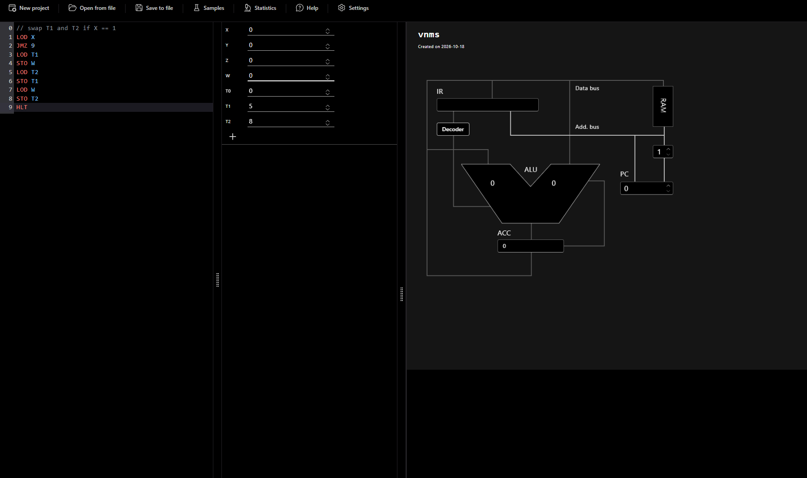
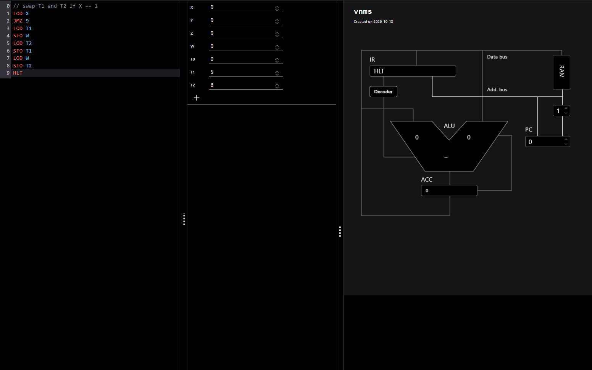
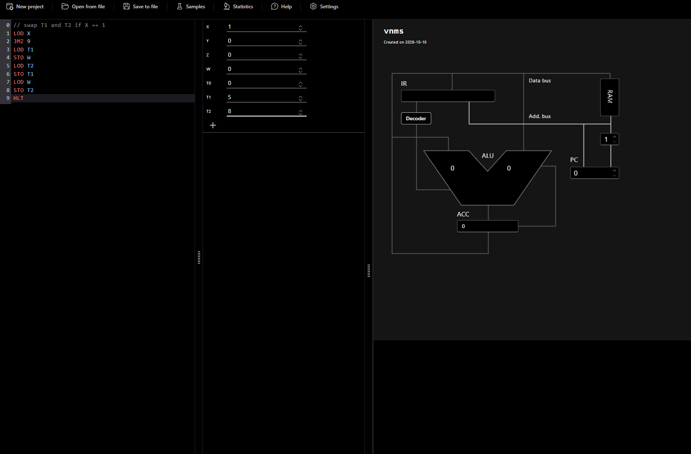
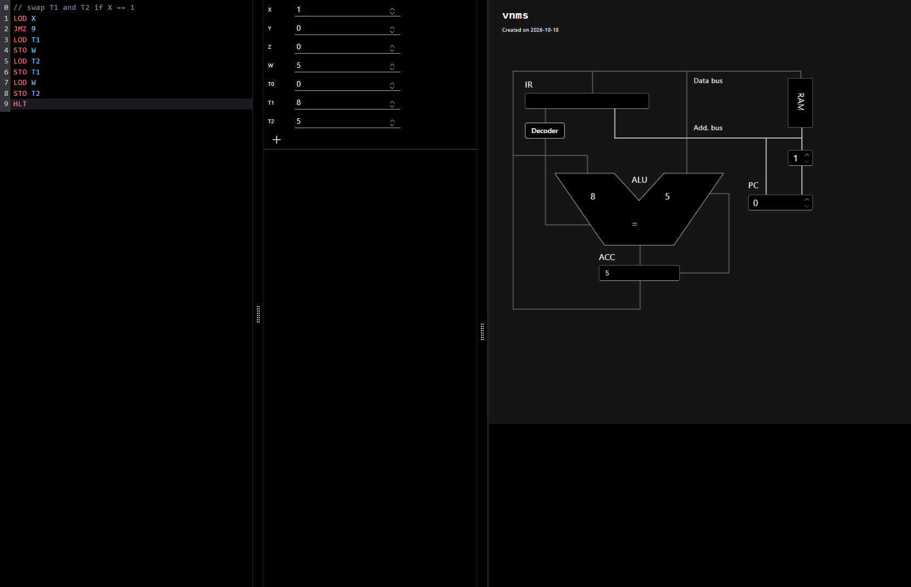

# Exercise 3: Conditional Swapping of Two Numbers (vnmsim)

**Objective:** write a program for the `vnmsim` simulator that swaps two numbers based on a condition, and document how it behaves.

**Requirements:**
- The numbers are stored in `T1` and `T2`.
- Control value `X`: if `X = 0` the numbers are **not** swapped; if `X = 1` they **are** swapped.
- The (possibly swapped) numbers are stored back in `T1` and `T2`.

## Table of contents

- [Program code](#program-code)
- [Design and logic](#design-and-logic)
- [Test runs](#test-runs)
- [Analysis of the results](#analysis-of-the-results)
- [Challenges and how I solved them](#challenges-and-how-i-solved-them)
- [Limitations](#limitations)

---

## Program code

File: `P1_EX3_initials.txt`

```
0   // swap T1 and T2 if X == 1
1   LOD X
2   JMZ 9
3   LOD T1
4   STO W
5   LOD T2
6   STO T1
7   LOD W
8   STO T2
9   HLT
```

## Design and logic

The simulator has no swap instruction and no way to copy one variable into another directly. Every transfer goes through the accumulator (`LOD` then `STO`). If `T1` were simply overwritten with `T2`, the old value of `T1` would be lost. The program therefore uses a **temporary variable `W`**.

| Line | Instruction | Effect |
|---|---|---|
| 1 | `LOD X` | ACC = X (the control value) |
| 2 | `JMZ 9` | if ACC = 0, jump to `HLT` (no swap) |
| 3 | `LOD T1` | ACC = T1 |
| 4 | `STO W` | W = T1 (save the old T1) |
| 5 | `LOD T2` | ACC = T2 |
| 6 | `STO T1` | T1 = T2 |
| 7 | `LOD W` | ACC = old T1 |
| 8 | `STO T2` | T2 = old T1 |
| 9 | `HLT` | stop |

**Conditional logic:** `JMZ` is the only conditional branch in the instruction set. After `LOD X`, `JMZ 9` skips the whole swap block when `X = 0`. For any other value of `X` the swap runs. The specification only defines `X = 0` and `X = 1`, and the program handles both as required. Other values of `X` were not tested, but by the code they would behave like `X = 1`.

## Test runs

Both runs use `T1 = 5`, `T2 = 8`, `W = 0`, so that a swap is easy to see.

### Test 1: `X = 0` (no swap expected)

| | Initial | Final |
|---|---|---|
| X | 0 | 0 |
| T1 | 5 | 5 |
| T2 | 8 | 8 |
| W | 0 | 0 |
| ACC | 0 | 0 |
| IR | empty | HLT |
| ALU | 0, 0 | 0, 0 |
| PC | 0 | 0 |

| Initial state | Final state |
|---|---|
|  |  |

Execution path: `LOD X` (ACC = 0) → `JMZ 9` is taken → `HLT`. The swap block is skipped.

### Test 2: `X = 1` (swap expected)

| | Initial | Final |
|---|---|---|
| X | 1 | 1 |
| T1 | 5 | **8** |
| T2 | 8 | **5** |
| W | 0 | **5** |
| ACC | 0 | **5** |
| IR | empty | empty |
| ALU | 0, 0 | 8, 5 |
| PC | 0 | 0 |

| Initial state | Final state |
|---|---|
|  |  |

Execution path and values (traced by hand and matching the final screenshot):

| Step | Instruction | ACC | T1 | T2 | W |
|---|---|---|---|---|---|
| 1 | `LOD X` | 1 | 5 | 8 | 0 |
| 2 | `JMZ 9` | 1 (not zero, no jump) | 5 | 8 | 0 |
| 3 | `LOD T1` | 5 | 5 | 8 | 0 |
| 4 | `STO W` | 5 | 5 | 8 | 5 |
| 5 | `LOD T2` | 8 | 5 | 8 | 5 |
| 6 | `STO T1` | 8 | 8 | 8 | 5 |
| 7 | `LOD W` | 5 | 8 | 8 | 5 |
| 8 | `STO T2` | 5 | 8 | 5 | 5 |
| 9 | `HLT` | 5 | 8 | 5 | 5 |

## Analysis of the results

- With `X = 0`, `T1` and `T2` are unchanged (5 and 8), so the condition correctly prevents the swap.
- With `X = 1`, the numbers are exchanged: `T1` changed from 5 to 8 and `T2` from 8 to 5.
- The final `ACC = 5` and `W = 5` in test 2 match the trace: `W` keeps a copy of the original `T1`, and the last instruction before `HLT` that touched ACC loaded that value.
- The program works as intended for both required cases: **Yes**.

## Challenges and how I solved them

1. **No swap instruction.** The instruction set has only `LOD`, `STO`, arithmetic, `JMP`, `JMZ` and `HLT`. Solved with a temporary variable `W` that holds the old value of `T1` while it is overwritten.
2. **Only one conditional branch.** There is no "if X == 1" instruction, only "jump if ACC is zero". Solved by loading X into ACC and using `JMZ` to skip the swap when X is zero.
3. **Jump target.** `JMZ` needs the absolute line number of `HLT`. The line numbers in the editor start at 0 (the comment line), so `HLT` is line 9, and `JMZ 9` was written accordingly.
4. **Side effect on `W`.** The temporary variable keeps the old `T1` after the swap (`W = 5`). This does not affect the result, but it means `W` is not restored to its initial value.

## Limitations

- Only `X = 0` and `X = 1` were run in the simulator.
- In the final screenshot of test 1, IR shows `HLT`; in test 2 it is empty. I could not explain this difference from the screenshots, so the values are reported as observed. The ALU readings are also reported without interpretation.
