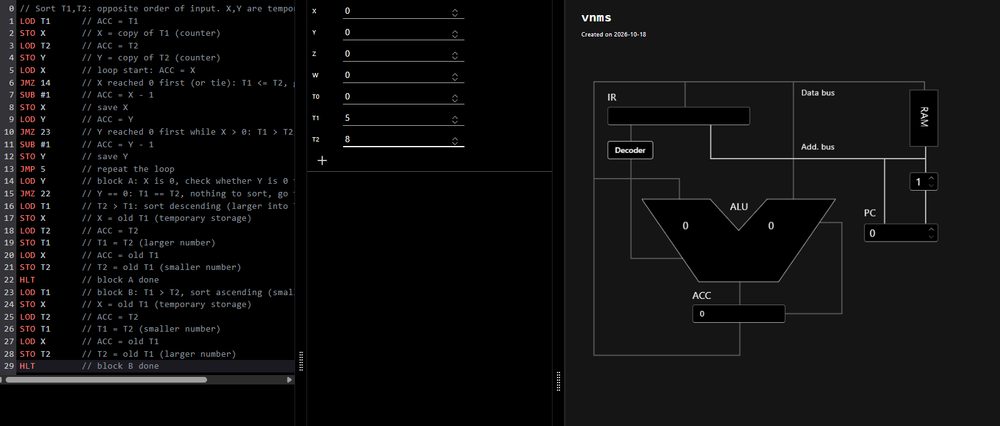
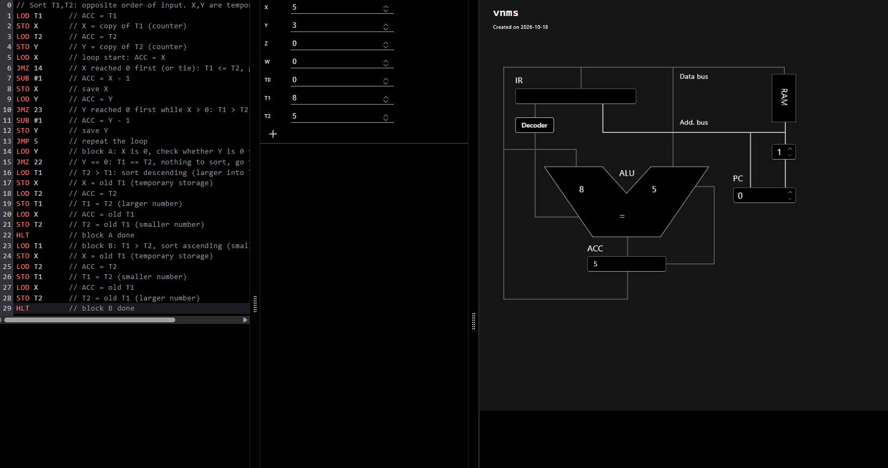
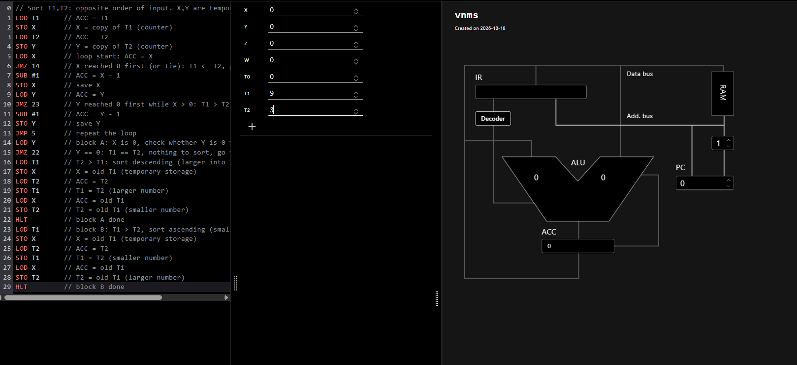
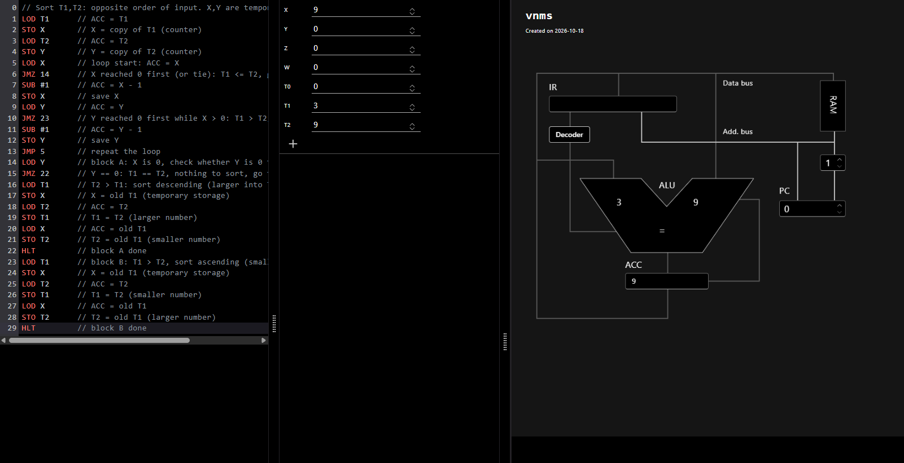
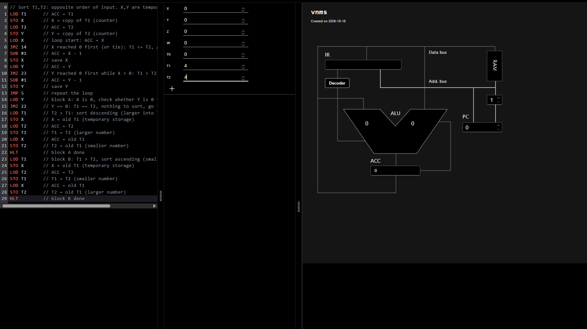
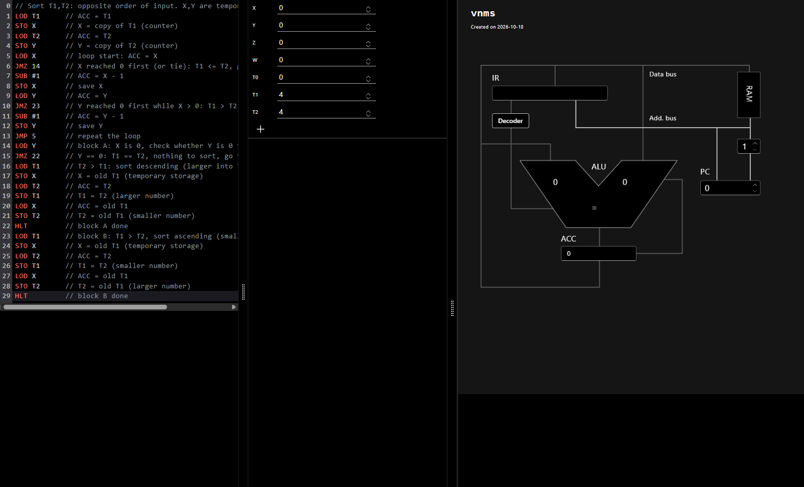

# Exercise 4: Sorting Two Numbers (vnmsim)

**Objective:** write a program for the `vnmsim` simulator that sorts two numbers in descending or ascending order.

**Requirements:**
- The two numbers are stored in `T1` and `T2`.
- `X` and `Y` are used as temporary registers.
- If `T2 > T1`, the numbers are sorted in descending order.
- If `T1 > T2`, the numbers are sorted in ascending order.
- The sorted numbers are stored back in `T1` and `T2`.

## Table of contents

- [Interpretation of the task](#interpretation-of-the-task)
- [Program code](#program-code)
- [Design and logic](#design-and-logic)
- [Test runs](#test-runs)
- [Analysis of the results](#analysis-of-the-results)
- [Challenges and how I solved them](#challenges-and-how-i-solved-them)
- [Limitations](#limitations)

---

## Interpretation of the task

The wording of the task can be read in different ways. I implemented the literal reading:

| Input condition | Required result | Resulting order |
|---|---|---|
| `T2 > T1` | larger number in `T1`, smaller in `T2` | descending |
| `T1 > T2` | smaller number in `T1`, larger in `T2` | ascending |
| `T1 = T2` | nothing to do | unchanged |

In both cases the order of the input is **reversed**, so the numbers are exchanged. The two cases are still kept as separate blocks of code (block A and block B) so that each requirement of the task is visible in the program.

## Program code

File: `P1_EX4_initials.txt`

```
0   // Sort T1,T2: opposite order of input. X,Y are temporary registers
1   LOD T1      // ACC = T1
2   STO X       // X = copy of T1 (counter)
3   LOD T2      // ACC = T2
4   STO Y       // Y = copy of T2 (counter)
5   LOD X       // loop start: ACC = X
6   JMZ 14      // X reached 0 first (or tie): T1 <= T2, go to block A
7   SUB #1      // ACC = X - 1
8   STO X       // save X
9   LOD Y       // ACC = Y
10  JMZ 23      // Y reached 0 first while X > 0: T1 > T2, go to block B
11  SUB #1      // ACC = Y - 1
12  STO Y       // save Y
13  JMP 5       // repeat the loop
14  LOD Y       // block A: X is 0, check whether Y is 0 too
15  JMZ 22      // Y == 0: T1 == T2, nothing to sort, go to HLT
16  LOD T1      // T2 > T1: sort descending (larger into T1). ACC = T1
17  STO X       // X = old T1 (temporary storage)
18  LOD T2      // ACC = T2
19  STO T1      // T1 = T2 (larger number)
20  LOD X       // ACC = old T1
21  STO T2      // T2 = old T1 (smaller number)
22  HLT         // block A done
23  LOD T1      // block B: T1 > T2, sort ascending (smaller into T1). ACC = T1
24  STO X       // X = old T1 (temporary storage)
25  LOD T2      // ACC = T2
26  STO T1      // T1 = T2 (smaller number)
27  LOD X       // ACC = old T1
28  STO T2      // T2 = old T1 (larger number)
29  HLT         // block B done
```

## Design and logic

The instruction set has no comparison instruction. The only conditional branch is `JMZ` (jump if ACC is zero), so the program compares the numbers by **counting both down to zero at the same time** and checking which counter reaches zero first. The smaller number reaches zero first.

**Phase 1: copy (lines 1-4).** `T1` and `T2` are copied into the temporary registers `X` and `Y`. The counters are decremented, not the originals, so `T1` and `T2` stay intact until the final exchange.

**Phase 2: compare (lines 5-13).** In each iteration, `X` is tested with `JMZ`; if it is not zero it is decremented. Then `Y` is tested and decremented the same way. `JMP 5` repeats the loop.

- If `X` is zero at the start of an iteration, then `T1 <= T2` and execution continues in block A (line 14).
- If `Y` reaches zero while `X` is still greater than zero, then `T1 > T2` and execution continues in block B (line 23).

**Block A (lines 14-22), `T1 <= T2`.** Line 14-15 check whether `Y` is also zero. If it is, the numbers are equal and the program halts without changes. Otherwise `T2 > T1`, and the program sorts in descending order: the larger number (`T2`) goes into `T1`, the smaller into `T2`. The exchange uses `X` as temporary storage, which is safe because the counters are no longer needed.

**Block B (lines 23-29), `T1 > T2`.** The program sorts in ascending order: the smaller number (`T2`) goes into `T1`, the larger into `T2`, again through `X`.

Note that blocks A and B perform the same operation (an exchange). They are kept separate to mirror the two cases of the task.

## Test runs

All tests start with `X = 0`, `Y = 0`.

### Test 1: `T1 = 5`, `T2 = 8` (`T2 > T1`, block A)

| | Initial | Final |
|---|---|---|
| T1 | 5 | **8** |
| T2 | 8 | **5** |
| X | 0 | 5 |
| Y | 0 | 3 |
| ACC | 0 | 5 |
| IR | empty | empty |
| ALU | 0, 0 | 8, 5 |
| PC | 0 | 0 |

| Initial state | Final state |
|---|---|
|  |  |

Trace: `X = 5`, `Y = 8`. After 5 iterations `X = 0`, `Y = 3`. On the next pass `LOD X` gives 0, so `JMZ 14` jumps to block A. `Y = 3` is not zero, so the numbers differ and the exchange runs: `X = 5` (old T1), `T1 = 8`, `T2 = 5`. The final `X = 5`, `Y = 3`, `ACC = 5` match the screenshot.

### Test 2: `T1 = 9`, `T2 = 3` (`T1 > T2`, block B)

| | Initial | Final |
|---|---|---|
| T1 | 9 | **3** |
| T2 | 3 | **9** |
| X | 0 | 9 |
| Y | 0 | 0 |
| ACC | 0 | 9 |
| IR | empty | empty |
| ALU | 0, 0 | 3, 9 |
| PC | 0 | 0 |

| Initial state | Final state |
|---|---|
|  |  |

Trace: `X = 9`, `Y = 3`. After 3 iterations `Y = 0` and `X = 6`. On the next pass `X` is not zero and is decremented, then `LOD Y` gives 0, so `JMZ 23` jumps to block B. The exchange runs: `X = 9` (old T1), `T1 = 3`, `T2 = 9`. The final `X = 9`, `Y = 0`, `ACC = 9` match the screenshot.

### Test 3: `T1 = 4`, `T2 = 4` (equal numbers)

| | Initial | Final |
|---|---|---|
| T1 | 4 | 4 |
| T2 | 4 | 4 |
| X | 0 | 0 |
| Y | 0 | 0 |
| ACC | 0 | 0 |
| IR | empty | empty |
| ALU | 0, 0 | 0, 0 |
| PC | 0 | 0 |

| Initial state | Final state |
|---|---|
|  |  |

Trace: both counters reach zero after 4 iterations. On the next pass `LOD X` gives 0, so `JMZ 14` jumps to block A. There `LOD Y` also gives 0, so `JMZ 22` jumps to `HLT`. The numbers are left unchanged.

## Analysis of the results

| Test | Input (T1, T2) | Output (T1, T2) | Branch | Correct? |
|---|---|---|---|---|
| 1 | 5, 8 | 8, 5 | block A (descending) | Yes |
| 2 | 9, 3 | 3, 9 | block B (ascending) | Yes |
| 3 | 4, 4 | 4, 4 | tie, no change | Yes |

All three tests cover every path through the program: block A with an exchange, block B with an exchange, and the tie case that halts without changes. The final values of `X`, `Y` and `ACC` in each test agree with the hand traces, which confirms the execution path. `X` and `Y` end with leftover values, which is acceptable because they are temporary registers.

## Challenges and how I solved them

1. **No comparison instruction.** There is no "greater than" instruction. Solved by counting copies of both numbers down in parallel and seeing which reaches zero first.
2. **Only `JMZ` for branching.** Every decision is a test for zero. Solved by loading each counter into ACC before every `JMZ`.
3. **Equal numbers.** If both counters reach zero in the same iteration, the program would otherwise treat the case as `T1 < T2`. Solved by an extra check at the start of block A (`LOD Y`, `JMZ 22`) that halts when `Y` is also zero.
4. **No swap instruction and only two free registers.** The exchange needs temporary storage. Solved by reusing `X` after the comparison loop is finished, since the counters are not needed anymore. `Y` is left holding its last value.
5. **Jump addresses.** `JMZ` and `JMP` use absolute line numbers, and the editor counts the comment on line 0. Every address (`5`, `14`, `22`, `23`) was checked against the editor numbering.
6. **Ambiguous task wording.** The two sorting rules in the task were read literally (reverse the order in both cases). This interpretation is stated at the top of this report.

## Limitations

- The method works for **non-negative integers**. A negative counter never reaches zero when it is decremented, so with two negative numbers the loop would not terminate. This follows from the code and was not tested in the simulator.
- The running time grows with the smaller of the two numbers, since the loop runs about `min(T1, T2)` times.
- Only three input combinations were run in the simulator.
- IR is empty in all final screenshots of this exercise. I could not explain this from the screenshots, so the values are reported as observed. ALU readings are also reported without interpretation.
