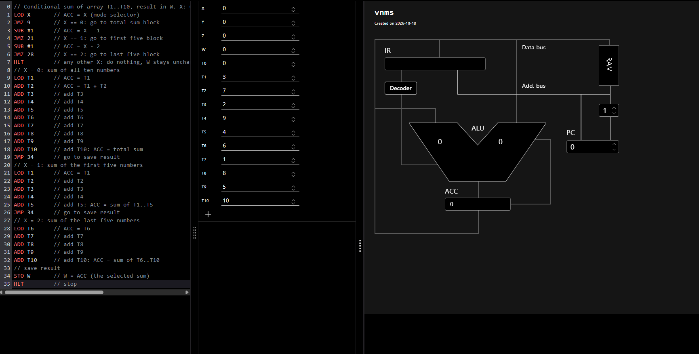
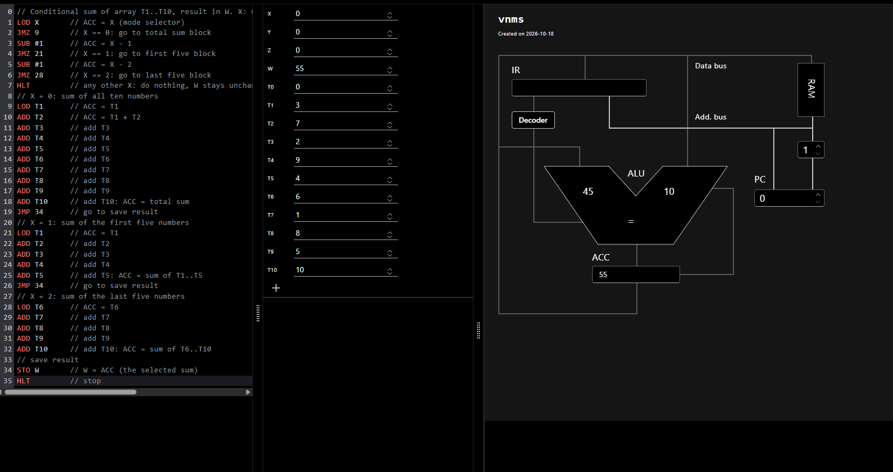
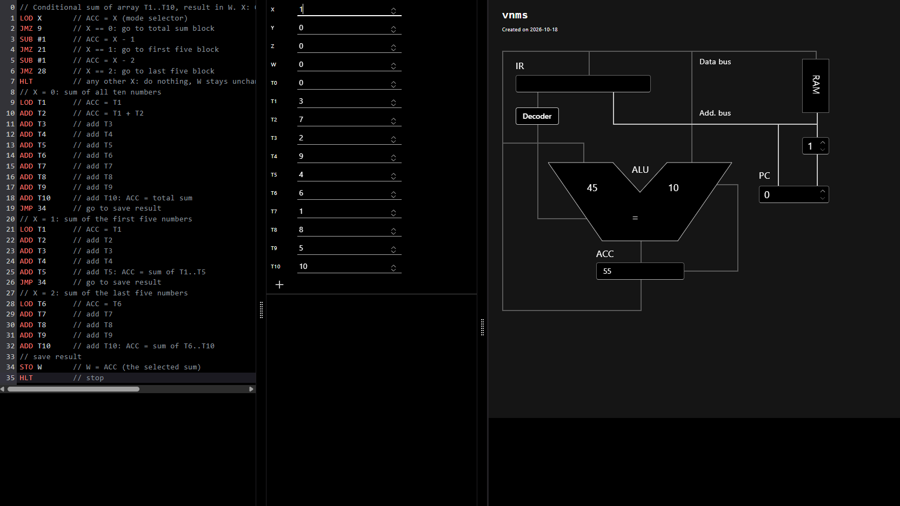
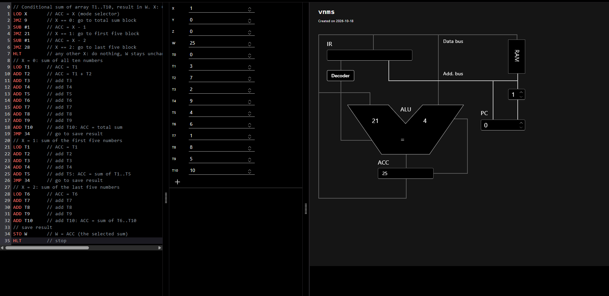
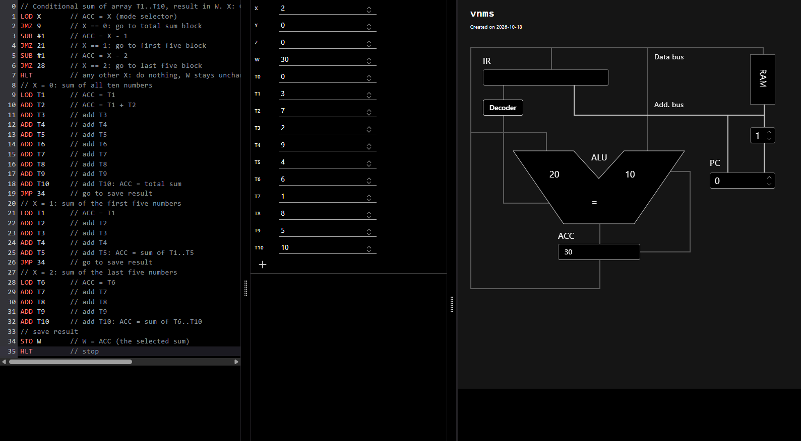
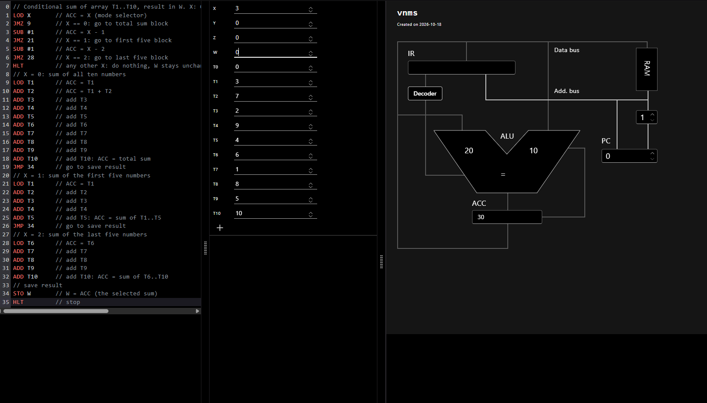
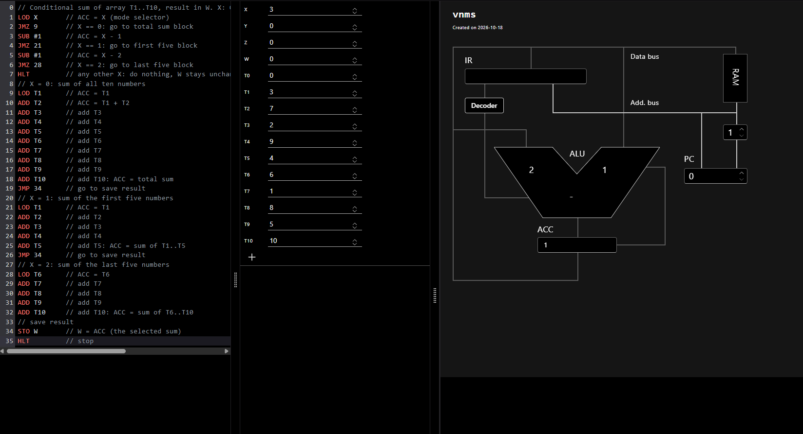

# Exercise 5: Conditional Addition of Numbers from an Array (vnmsim)

**Objective:** process an array of 10 numbers and calculate different sums, depending on a control value `X`.

**Requirements:**
- The 10 numbers are stored in `T1`...`T10`.
- `X = 0`: sum of the whole array.
- `X = 1`: sum of the first five numbers (`T1`...`T5`).
- `X = 2`: sum of the last five numbers (`T6`...`T10`).
- Any other `X`: do nothing.

The task does not say where to store the result, so I chose the variable **`W`**.

## Table of contents

- [Program code](#program-code)
- [Approach to the conditional logic](#approach-to-the-conditional-logic)
- [Array processing within the vnmsim constraints](#array-processing-within-the-vnmsim-constraints)
- [Test data and runs](#test-data-and-runs)
- [Analysis of the results](#analysis-of-the-results)
- [Challenges and how I solved them](#challenges-and-how-i-solved-them)
- [Limitations](#limitations)

---

## Program code

File: `P1_EX5_initials.txt`

```
0   // Conditional sum of array T1..T10, result in W. X: 0=all, 1=first five, 2=last five, other=nothing
1   LOD X       // ACC = X (mode selector)
2   JMZ 9       // X == 0: go to total sum block
3   SUB #1      // ACC = X - 1
4   JMZ 21      // X == 1: go to first five block
5   SUB #1      // ACC = X - 2
6   JMZ 28      // X == 2: go to last five block
7   HLT         // any other X: do nothing, W stays unchanged
8   // X = 0: sum of all ten numbers
9   LOD T1      // ACC = T1
10  ADD T2      // ACC = T1 + T2
11  ADD T3      // add T3
12  ADD T4      // add T4
13  ADD T5      // add T5
14  ADD T6      // add T6
15  ADD T7      // add T7
16  ADD T8      // add T8
17  ADD T9      // add T9
18  ADD T10     // add T10: ACC = total sum
19  JMP 34      // go to save result
20  // X = 1: sum of the first five numbers
21  LOD T1      // ACC = T1
22  ADD T2      // add T2
23  ADD T3      // add T3
24  ADD T4      // add T4
25  ADD T5      // add T5: ACC = sum of T1..T5
26  JMP 34      // go to save result
27  // X = 2: sum of the last five numbers
28  LOD T6      // ACC = T6
29  ADD T7      // add T7
30  ADD T8      // add T8
31  ADD T9      // add T9
32  ADD T10     // add T10: ACC = sum of T6..T10
33  // save result
34  STO W       // W = ACC (the selected sum)
35  HLT         // stop
```

## Approach to the conditional logic

`JMZ` (jump if ACC is zero) is the only conditional branch, so a multi-way choice has to be built from a chain of zero tests. The program loads `X` into ACC and tests it:

1. `JMZ 9`: if `X = 0`, jump to the total-sum block.
2. Otherwise `SUB #1` makes ACC equal to `X - 1`, and `JMZ 21` jumps to the first-five block when `X = 1`.
3. Otherwise `SUB #1` makes ACC equal to `X - 2`, and `JMZ 28` jumps to the last-five block when `X = 2`.
4. If none of the tests matched, execution reaches `HLT` on line 7. `STO W` is never executed, so `W` is not changed ("does nothing").

Each sum block ends by reaching the common ending (`STO W`, `HLT`). The first two blocks use `JMP 34` to skip the blocks that follow, and the last block simply continues into `STO W`.

## Array processing within the vnmsim constraints

The simulator has no indexed addressing and no way to loop over `T1`...`T10` by an index: every instruction names its variable directly. The array elements are separate variables, so the sums are computed by **straight-line, unrolled code**: `LOD` loads the first element into ACC and a sequence of `ADD Tn` instructions adds the others one by one, with the running total kept in ACC. The three cases differ only in which elements are included:

| Case | Elements | Instructions |
|---|---|---|
| X = 0 | T1...T10 | `LOD T1`, then `ADD T2`...`ADD T10` (lines 9-18) |
| X = 1 | T1...T5 | `LOD T1`, then `ADD T2`...`ADD T5` (lines 21-25) |
| X = 2 | T6...T10 | `LOD T6`, then `ADD T7`...`ADD T10` (lines 28-32) |

The array itself is only read, never modified.

## Test data and runs

Array used in all tests:

| T1 | T2 | T3 | T4 | T5 | T6 | T7 | T8 | T9 | T10 |
|---|---|---|---|---|---|---|---|---|---|
| 3 | 7 | 2 | 9 | 4 | 6 | 1 | 8 | 5 | 10 |

Expected sums: all = 55, first five = 25, last five = 30. In every test `Y = 0`, `Z = 0`, `T0 = 0` and `W = 0` before the run.

### Test 1: `X = 0` (total sum)

| | Initial | Final |
|---|---|---|
| X | 0 | 0 |
| W | 0 | **55** |
| ACC | 0 | **55** |
| ALU | 0, 0 | 45, 10 |
| IR | empty | empty |
| PC | 0 | 0 |

| Initial state | Final state |
|---|---|
|  |  |

Running total in ACC: 3, 10, 12, 21, 25, 31, 32, 40, 45, **55**. The ALU shows 45 and 10, the operands of the last addition (`ADD T10`).

### Test 2: `X = 1` (first five)

| | Initial | Final |
|---|---|---|
| X | 1 | 1 |
| W | 0 | **25** |
| ACC | 55 (left from test 1) | **25** |
| ALU | 45, 10 (left from test 1) | 21, 4 |
| IR | empty | empty |
| PC | 0 | 0 |

| Initial state | Final state |
|---|---|
|  |  |

Running total: 3, 10, 12, 21, **25**. The ALU shows 21 and 4, the operands of the last addition (`ADD T5`).

### Test 3: `X = 2` (last five)

| | Initial | Final |
|---|---|---|
| X | 2 | 2 |
| W | 0 | **30** |
| ACC | 25 (left from test 2) | **30** |
| ALU | 21, 4 (left from test 2) | 20, 10 |
| IR | empty | empty |
| PC | 0 | 0 |

| Initial state | Final state |
|---|---|
|  |  |

Running total: 6, 7, 15, 20, **30**. The ALU shows 20 and 10, the operands of the last addition (`ADD T10`).

### Test 4: `X = 3` (other value, nothing should happen)

| | Initial | Final |
|---|---|---|
| X | 3 | 3 |
| W | 0 | **0 (unchanged)** |
| ACC | 30 (left from test 3) | 1 |
| ALU | 20, 10 (left from test 3) | 2, 1 (operation shown: "-") |
| IR | empty | empty |
| PC | 0 | 0 |

| Initial state | Final state |
|---|---|
|  |  |

Path: `LOD X` (ACC = 3), `JMZ 9` not taken, `SUB #1` (ACC = 2), `JMZ 21` not taken, `SUB #1` (ACC = 1), `JMZ 28` not taken, `HLT`. The ALU shows 2 and 1, the operands of the last subtraction. `W` and the array are untouched.

## Analysis of the results

| Test | X | Expected W | Actual W | Correct? |
|---|---|---|---|---|
| 1 | 0 | 55 | 55 | Yes |
| 2 | 1 | 25 | 25 | Yes |
| 3 | 2 | 30 | 30 | Yes |
| 4 | 3 | unchanged (0) | 0 | Yes |

- All four cases behave as specified, and the final `ACC`, `W` and ALU values agree with the hand-calculated running totals.
- In every test `T1`...`T10` are unchanged after the run.
- In test 4 the program "does nothing" in the sense that the array and the result variable are not changed. `ACC` is modified (it ends at 1) because the dispatch chain decrements it, which is expected and not part of the result.
- For any `X` other than 0, 1 or 2, the dispatch chain reaches the `HLT` on line 7 (by code inspection; only `X = 3` was run in the simulator).

## Challenges and how I solved them

1. **No array indexing or element-wise loop.** The elements are separate variables and each instruction names its variable explicitly. Solved by unrolling the sums into straight-line `ADD` sequences.
2. **Only one conditional branch (`JMZ`).** A three-way choice (plus a "do nothing" case) cannot be expressed directly. Solved with a chain of `SUB #1` and `JMZ` tests, the same technique as in the sample calculator program.
3. **Result location not specified.** I chose `W` and kept all three cases writing to it through one shared `STO W`.
4. **"Does nothing" case.** The fall-through of the dispatch chain goes to its own `HLT` before `STO W`, so `W` keeps its value.
5. **Jump addresses.** The editor counts the comment lines, so every `JMZ` and `JMP` address (9, 21, 28, 34) was checked against the editor numbering.
6. **Test isolation.** The simulator keeps `ACC`, ALU and `W` from the previous run. `W` was set to 0 before each test so the result was clearly written by that run. The leftover `ACC` and ALU values are visible in the initial screenshots of tests 2-4.

## Limitations

- Only one data set (10 numbers) and one value of `X` outside the range (3) were run in the simulator.
- The location of the result (`W`) is my own choice, since the task does not define it.
- Very large sums and negative numbers were not tested.
- IR is empty in all final screenshots of this exercise. I could not explain this from the screenshots, so the values are reported as observed.
