# Exercise 2: Exploring Pre-existing Programs (vnmsim)

**Objective:** understand the limited instruction set of the `vnmsim` von Neumann simulator and document the behavior of the sample programs.

For each program I ran it, analyzed it, recorded the initial and final simulator state (screenshots), and evaluated whether it works as intended.

## Table of contents

- [Architecture and instruction set](#architecture-and-instruction-set)
- [Results at a glance](#results-at-a-glance)
- [Programs 1-4: Basic arithmetic](#programs-1-4-basic-arithmetic)
- [Program 5: Basics (calculator)](#program-5-basics-calculator)
- [Program 6: Power](#program-6-power)
- [Program 7: Square root](#program-7-square-root)
- [Program 8: Modulo](#program-8-modulo)
- [Program 9: Greater than](#program-9-greater-than)
- [Program 10: Is even](#program-10-is-even)
- [Program 11: Is negative](#program-11-is-negative)
- [Conclusions](#conclusions)
- [Limitations of this report](#limitations-of-this-report)

---

## Architecture and instruction set

The simulator models an accumulator-based von Neumann computer: **PC** (program counter), **IR** (instruction register) with a **Decoder**, an **ALU**, an accumulator **ACC**, and **RAM** that holds both code and variables (`X`, `Y`, `Z`, `W`, `T0`...).

| Instruction | Effect |
|---|---|
| `LOD v` | ACC = value of variable `v` (`LOD #n` loads the constant `n`) |
| `STO v` | variable `v` = ACC |
| `ADD v` / `SUB v` / `MUL v` / `DIV v` | ACC = ACC (op) `v`; `#n` is an immediate constant |
| `JMP a` | unconditional jump to address `a` |
| `JMZ a` | jump to address `a` only if ACC = 0 |
| `HLT` | stop |

Lines starting with `//` are comments and are not executed.

Key consequences of this small instruction set:

- Every computation goes through ACC.
- `JMZ` is the **only** conditional branch. Comparisons, sign tests, and parity tests have to be built from counters and `JMZ` (programs 5, 8-11).
- Division behaves as **integer division** (inferred from the behavior of programs 7 and 10, not from documentation).

---

## Results at a glance

| # | Program | Inputs | Result | Works as intended? |
|---|---|---|---|---|
| 1 | Addition | X=2, Y=2 | Z=4 | Yes |
| 2 | Subtraction | X=3, Y=2 | Z=1 | Yes |
| 3 | Multiplication | X=6, Y=7 | Z=42 | Yes |
| 4 | Division | X=12, Y=3 | Z=4 | Yes |
| 5 | Basics (calculator) | X=3, Y=0, Z=2 | W=5 | Yes |
| 6 | Power | X=3, Y=2 | Z=9 | Yes |
| 7 | Square root | X=25 | Y=5 | Yes |
| 8 | Modulo | X=3, Y=2 | Z=1 | Yes (name is misleading) |
| 9 | Greater than | X=3, Y=2 | Z=1 | Yes |
| 10 | Is even | X=4 | Z=1 | Yes |
| 11 | Is negative | X=-3 | Z=1 | Yes |

---

## Programs 1-4: Basic arithmetic

All four share one structure; only the ALU operation differs.

```
LOD X      // ACC = X
<OP> Y     // ADD, SUB, MUL or DIV: ACC = ACC (op) Y
STO Z      // Z = ACC
HLT
```

| # | Operation | X | Y | Z before | Z after | ACC after |
|---|---|---|---|---|---|---|
| 1 | `ADD` (X + Y) | 2 | 2 | 0 | **4** | 4 |
| 2 | `SUB` (X - Y) | 3 | 2 | 0 | **1** | 1 |
| 3 | `MUL` (X * Y) | 6 | 7 | 0 | **42** | 42 |
| 4 | `DIV` (X / Y) | 12 | 3 | 0 | **4** | 4 |

**Screenshots:** initial and final states

| Program | Initial | Final |
|---|---|---|
| 1 | 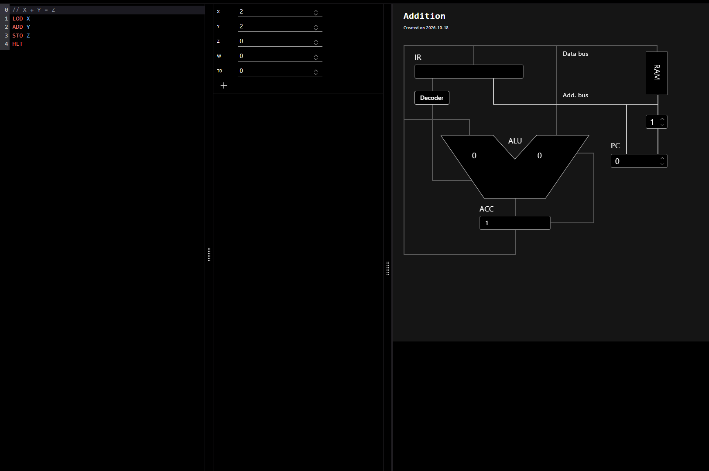 | 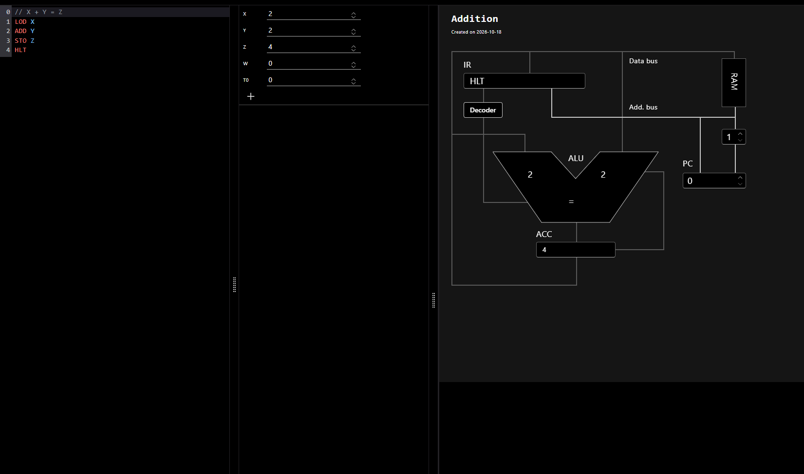 |
| 2 | 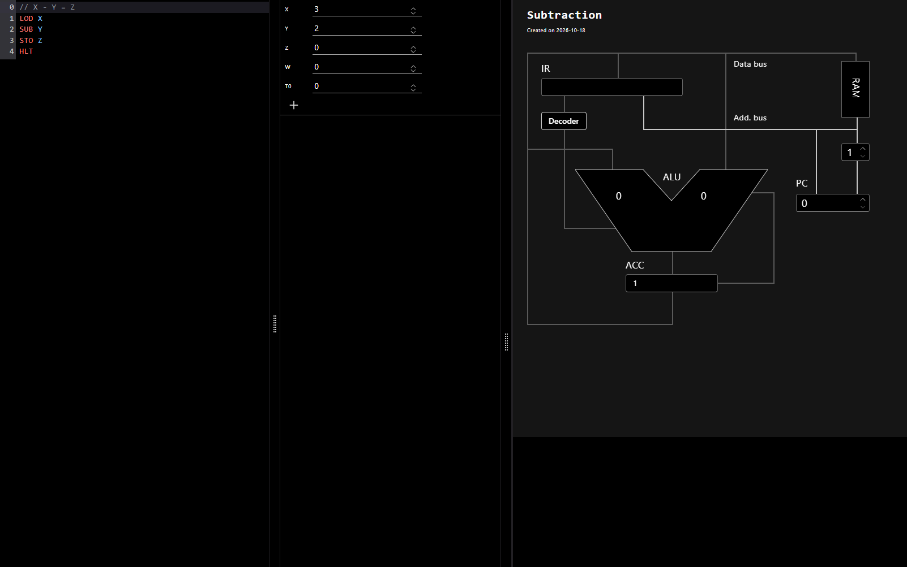 | 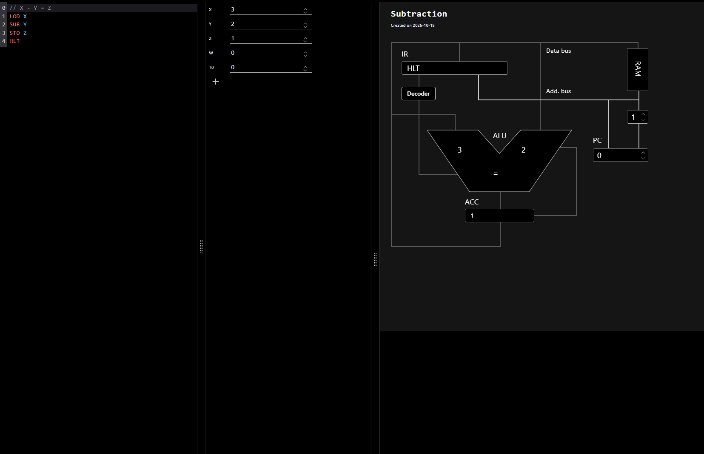 |
| 3 | 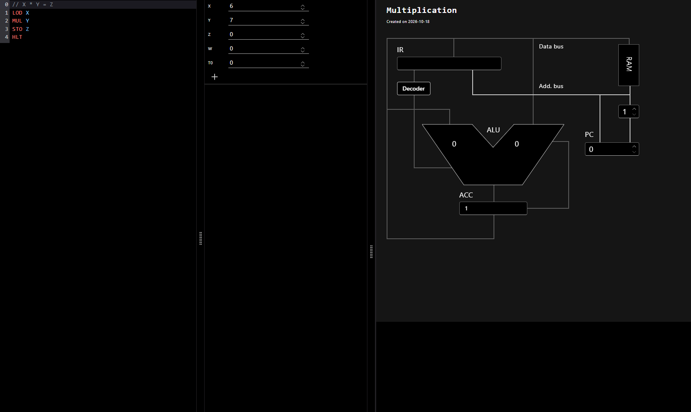 | 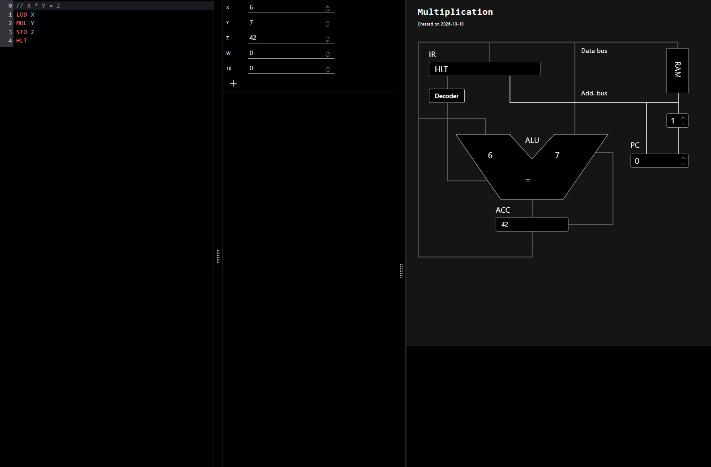 |
| 4 | 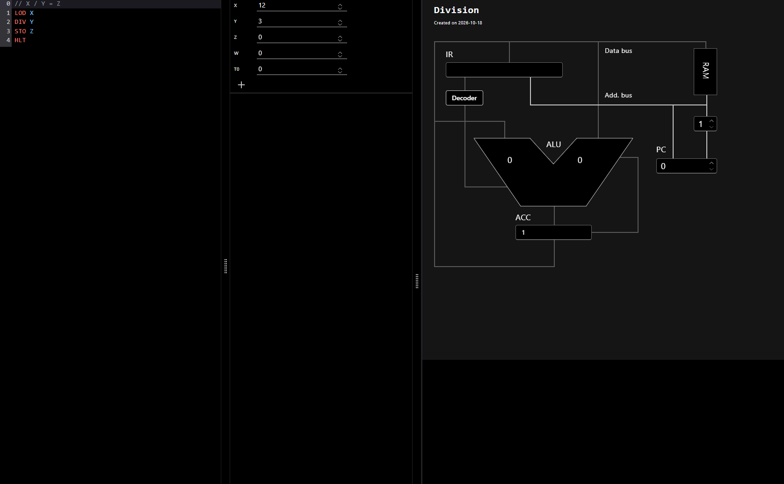 | 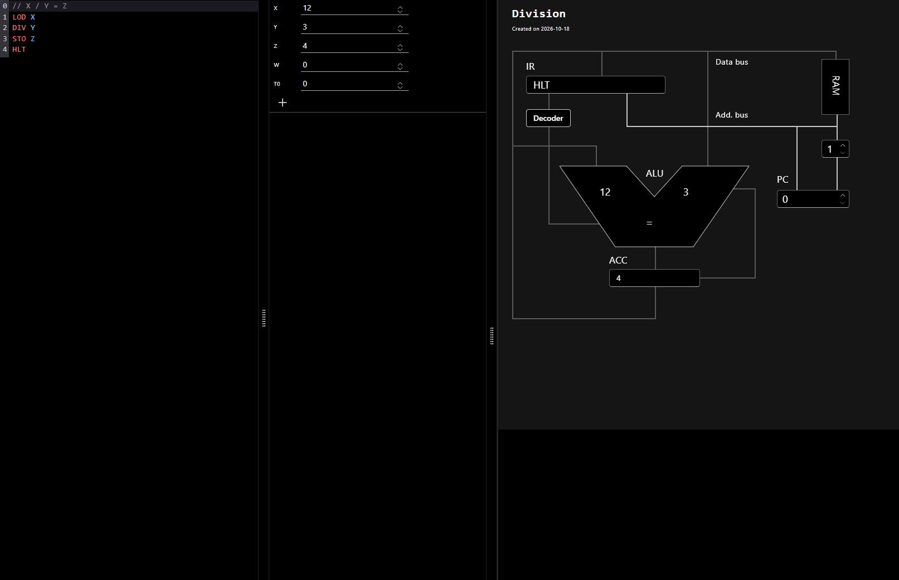 |

**How it works:** `LOD X` loads the first operand into ACC (overwriting whatever was there, so the initial ACC value is irrelevant). The ALU combines ACC with `Y` and writes the result back to ACC. `STO Z` saves it to memory and `HLT` stops. X and Y are only read, never modified. The ALU display after halting shows the two operands (for example 6 and 7 in program 3).

**Evaluation: Yes** for all four. The results equal the expected values. The operand order is correct for the non-commutative operations (3 - 2 = 1, 12 / 3 = 4).

---

## Program 5: Basics (calculator)

Computes **W = X (op) Z**, where `Y` selects the operation:

| Y | 0 | 1 | 2 | 3 |
|---|---|---|---|---|
| Operation | + | - | * | / |

```
3   LOD Y
4   JMZ 14     // Y == 0 -> addition
5   SUB #1
6   JMZ 19     // Y == 1 -> subtraction
7   SUB #1
8   JMZ 24     // Y == 2 -> multiplication
9   SUB #1
10  JMZ 29     // Y == 3 -> division
11  HLT        // any other Y: stop, W unchanged

14  LOD X      // addition block:  LOD X, ADD Z, JMP 33
15  ADD Z
16  JMP 33
...            // blocks for -, *, / at 19-21, 24-26, 29-31 (same shape)

33  STO W
34  HLT
```

**How it works:** the dispatch block loads the operation code and tests it with `JMZ`. If it is not zero, `SUB #1` decrements it and the next `JMZ` tests again, so each test corresponds to the next operation code. This is a creative workaround for having no "compare" instruction. Each operation block loads `X`, applies its ALU operation with `Z`, and jumps to the shared ending (`STO W`, `HLT`).

**Run:** X=3, Y=0, Z=2 (addition). Path: 3 → 4 → 14 → 15 → 16 → 33 → 34.

| | Initial | Final |
|---|---|---|
| X / Y / Z | 3 / 0 / 2 | 3 / 0 / 2 |
| W | 0 | **5** |
| ACC | 1 | **5** |
| IR | empty | HLT |
| ALU | 0, 0 | 3, 2 |
| PC | 3 | 0 |

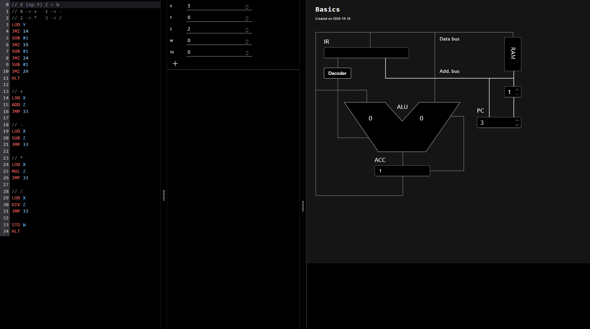 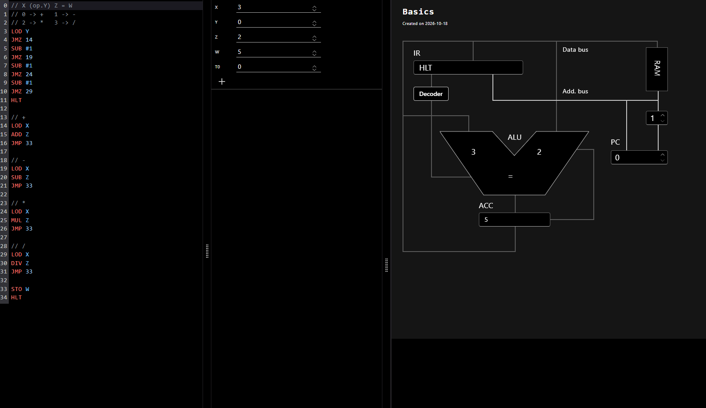

**Evaluation: Yes** for the tested branch (3 + 2 = 5). Only the addition branch was run, see [Limitations](#limitations-of-this-report).

---

## Program 6: Power

Computes **Z = X^Y** by repeated multiplication, using `Y` as the loop counter.

```
1   LOD #1
2   STO Z      // Z = 1
3   LOD Y
4   JMZ 12     // counter == 0 -> done
5   LOD Z
6   MUL X
7   STO Z      // Z = Z * X
8   LOD Y
9   SUB #1
10  STO Y      // Y = Y - 1
11  JMP 4
12  HLT
```

**Trace (X=3, Y=2):**

| Iteration | Y at start | Z after | Y after |
|---|---|---|---|
| 1 | 2 | 3 | 1 |
| 2 | 1 | 9 | 0 |
| check | 0 | `JMZ 12` exits | |

| | Initial | Final |
|---|---|---|
| X | 3 | 3 |
| Y | 2 | **0** |
| Z | 0 | **9** |
| ACC | 0 | 0 |
| IR | empty | HLT |
| ALU | 0, 0 | 1, 1 |

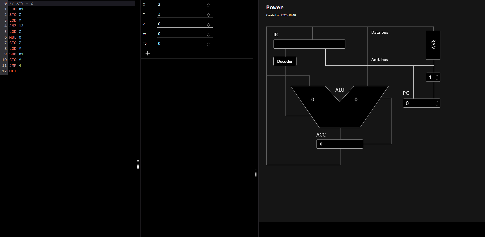 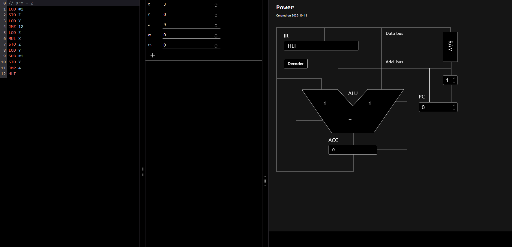

**Evaluation: Yes.** 3² = 9. **Side effect:** `Y` is consumed as the counter and ends at 0. For Y = 0 the loop body never runs and Z = 1 (X⁰ = 1), by code inspection.

---

## Program 7: Square root

Computes **Y = sqrt(X)** with the Babylonian (Newton) method: `Y = (Y + X/Y) / 2`.

```
1   LOD X
2   STO Y      // initial guess Y = X
3   DIV #2
4   STO Z      // iteration counter Z = X / 2
7   LOD Z
8   JMZ 20     // counter == 0 -> done
9   SUB #1
10  STO Z
12  LOD X
13  DIV Y
14  ADD Y
15  DIV #2
16  STO Y      // Y = (X/Y + Y) / 2
18  JMP 7
20  HLT
```

**Trace (X=25, integer division):** Y: 25 → 13 → 7 → 5, then stays at 5 until Z reaches 0 (12 iterations in total).

| | Initial | Final |
|---|---|---|
| X | 25 | 25 |
| Y | 0 | **5** |
| Z | 0 | 0 |
| ACC | 0 | 0 |
| IR | empty | HLT |
| ALU | 0, 0 | 10, 0 |

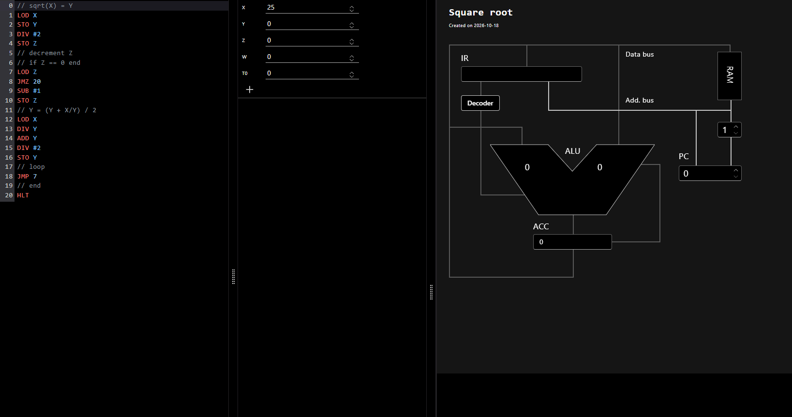 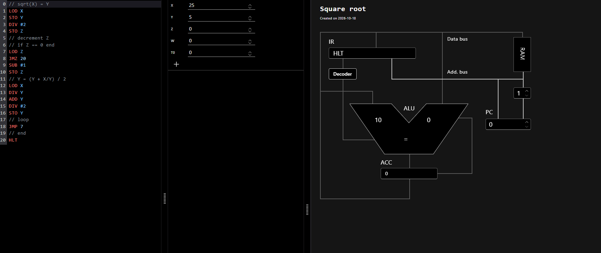

**Evaluation: Yes.** sqrt(25) = 5. The result is exact for perfect squares; for other inputs integer division gives an integer approximation. The program terminates because division is integer (with fractional division Z would never hit exactly 0). It is inefficient: Y converges in about 3-4 steps but X/2 iterations are always run. **Side effect:** Z is consumed.

---

## Program 8: Modulo

Despite the name, it does **not** compute a remainder. It compares X and Y (comment: `X > Y ? Z`): **Z = 1 if X > Y, otherwise Z = 0**.

```
1   LOD X
2   JMZ 11     // X reached 0 first (or at the same time) -> Z = 0
3   SUB #1
4   STO X
5   LOD Y
6   JMZ 15     // Y reached 0 first -> Z = 1
7   SUB #1
8   STO Y
9   JMP 1

11  LOD #0     // X <= Y
12  STO Z
13  HLT
15  LOD #1     // X > Y
16  STO Z
17  HLT
```

**How it works:** X and Y are decremented together; whichever reaches 0 first is the smaller one. For X=3, Y=2: Y hits 0 while X is still 1, so the "X > Y" branch runs.

| | Initial | Final |
|---|---|---|
| X | 3 | **0** |
| Y | 2 | **0** |
| Z | 0 | **1** |
| ACC | 0 | 1 |
| IR | empty | empty |
| ALU | 0, 0 | 0, 1 |

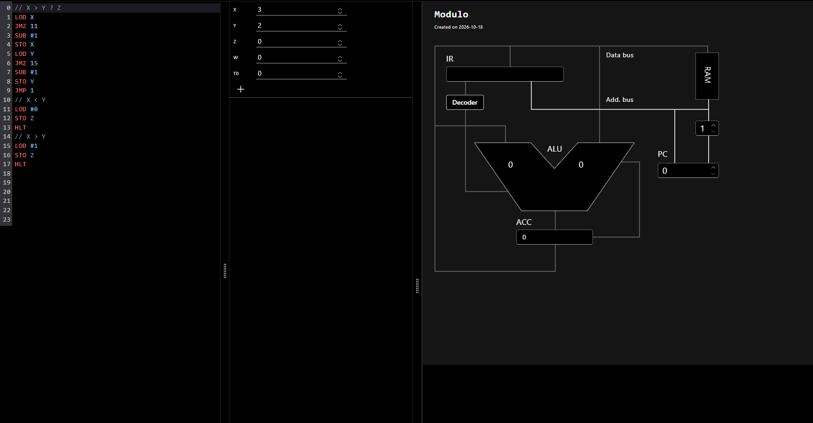 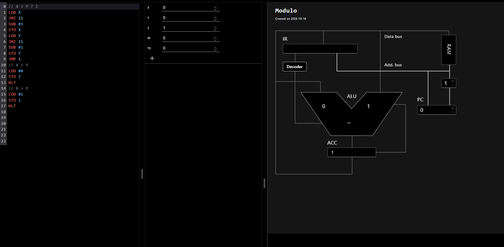

**Evaluation: Yes** as a comparison (3 > 2 → Z = 1). **Notes:** the name does not match the function; the inputs X and Y are destroyed; for X = Y the code gives Z = 0 (so the real meaning is "X ≤ Y → 0").

---

## Program 9: Greater than

Computes **Z = 1 if X > Y, otherwise 0**, and also handles negative numbers.

**Idea:** four counters are created: `T1 = +X`, `T2 = -X`, `T3 = +Y`, `T4 = -Y` (negation with `MUL #-1`). All are decremented in a loop. Of each pair, only the non-negative counter can reach 0, which both measures |X| (or |Y|) and reveals the sign.

| Lines | Purpose |
|---|---|
| 1-8 | Save `+X`, `-X`, `+Y`, `-Y` into T1-T4 |
| 11-27 | Main loop: test each counter with `JMZ`; if non-zero decrement it. `JMZ 30` when an X counter hits 0, `JMZ 41` when a Y counter hits 0 |
| 30-38 | X reached 0 first: keep decrementing T3/T4. T3 = 0 → `JMZ 57` (Z = 0), T4 = 0 → `JMZ 52` (Z = 1) |
| 41-49 | Y reached 0 first: keep decrementing T1/T2. T1 = 0 → `JMZ 52` (Z = 1), T2 = 0 → `JMZ 57` (Z = 0) |
| 52-54 | `LOD #1`, `STO Z`, `HLT` |
| 57-59 | `LOD #0`, `STO Z`, `HLT` |

**Trace (X=3, Y=2):** T1=3, T2=-3, T3=2, T4=-2 → after 2 iterations T3 = 0, T1 = 1 → on the third pass `LOD T3` is 0 → `JMZ 41` → `LOD T1` = 0 after decrement → `JMZ 52` → Z = 1.

| | Initial | Final |
|---|---|---|
| X / Y | 3 / 2 | 3 / 2 |
| Z | 0 | **1** |
| T1 / T2 / T3 / T4 | not visible | 0 / -6 / 0 / -4 |
| ACC | 0 | 1 |
| IR | empty | empty |
| ALU | 0, 0 | 0, 1 |

The final T1-T4 values match the hand trace, which confirms the execution path.

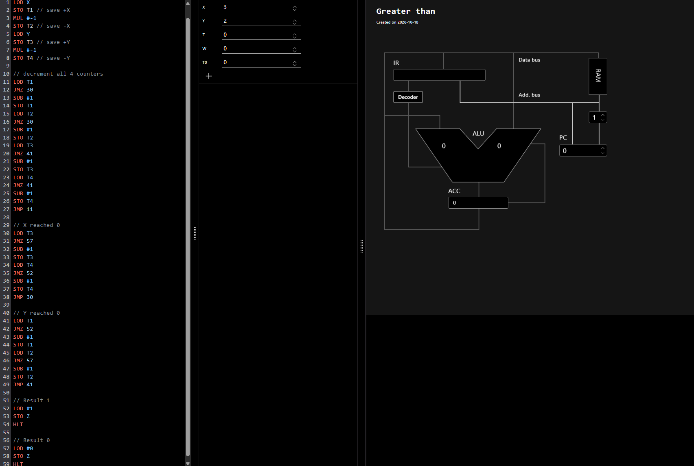 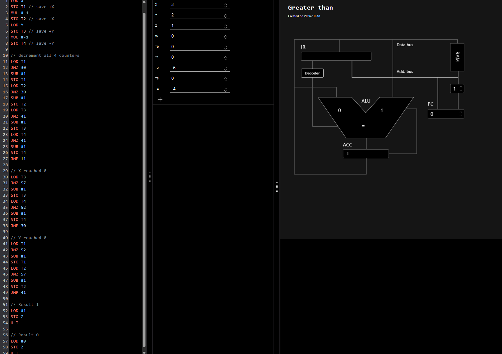

**Evaluation: Yes.** 3 > 2 → Z = 1. The comparison is strict (X = Y gives Z = 0, by code inspection). X and Y are unchanged because the loop works on the copies T1-T4.

---

## Program 10: Is even

Computes **Z = 1 if X is even, otherwise 0**, using integer division.

```
1   LOD X
2   DIV #2
3   MUL #2
4   STO Y      // Y = (X / 2) * 2
5   LOD X
6   SUB Y      // X - Y = remainder mod 2
7   JMZ 11     // remainder 0 -> even
8   LOD #0
9   STO Z      // odd: Z = 0
10  JMP 13
11  LOD #1
12  STO Z      // even: Z = 1
13  HLT
```

**Trace (X=4):** 4/2 = 2, 2*2 = 4 → Y = 4; 4 - 4 = 0 → `JMZ 11` → Z = 1. For X = 5: Y = 4, 5 - 4 = 1 → Z = 0 (by hand).

| | Initial | Final |
|---|---|---|
| X | 4 | 4 |
| Y | 0 | **4** |
| Z | 0 | **1** |
| T1-T4 | 0 / -6 / 0 / -4 | unchanged (left over from program 9) |
| ACC | 0 | **1** |
| IR | empty | empty |
| ALU | 0, 0 | 0, 1 |

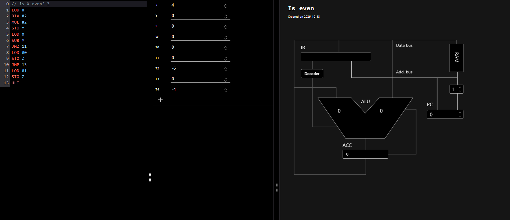 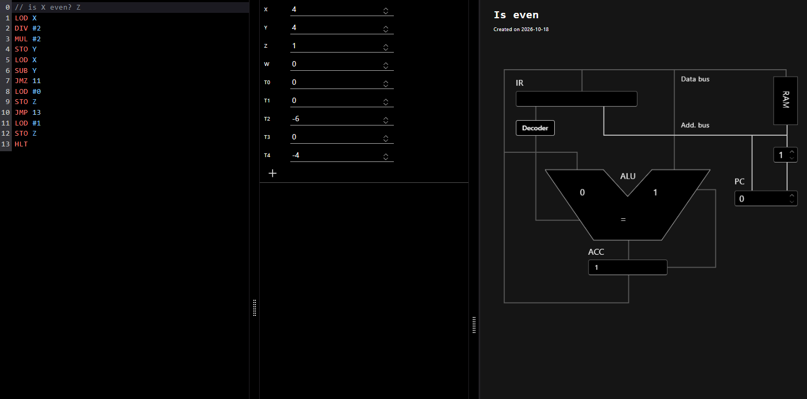

**Evaluation: Yes.** 4 is even → Z = 1. `Y` is overwritten as a temporary; X is preserved. The program only works because division is integer.

---

## Program 11: Is negative

Computes **Z = 1 if X < 0, otherwise 0** (zero counts as positive).

**Idea:** two counters race to zero: `T1 = X²` and `T2 = X² - X`. For X < 0, T2 = X² + |X| is larger, so **T1 hits 0 first**. For X > 0, T2 is smaller, so **T2 hits 0 first**.

```
1   LOD X
2   MUL X
3   STO T1     // T1 = X^2
4   SUB X
5   STO T2     // T2 = X^2 - X
6   JMZ 23     // X is 0 or 1 -> positive
8   LOD T1
9   JMZ 19     // T1 hit 0 first -> negative
10  SUB #1
11  STO T1
12  LOD T2
13  JMZ 23     // T2 hit 0 first -> positive
14  SUB #1
15  STO T2
16  JMP 7
19  LOD #1     // negative
20  JMP 27
23  LOD #0     // positive
24  JMP 27
27  STO Z
28  HLT
```

**Trace (X=-3):** T1 = 9, T2 = 12. After 9 iterations T1 = 0 and T2 = 3 → `JMZ 19` → ACC = 1 → Z = 1.

| | Initial | Final |
|---|---|---|
| X | -3 | -3 |
| Z | 0 | **1** |
| T1 | 0 | 0 |
| T2 | -6 (leftover from program 9) | **3** |
| T4 | -4 | -4 (not used) |
| ACC | 1 | 1 |
| IR | empty | empty |
| ALU | 0, 0 | 0, 1 |

The final T1 = 0 and T2 = 3 match the hand trace.

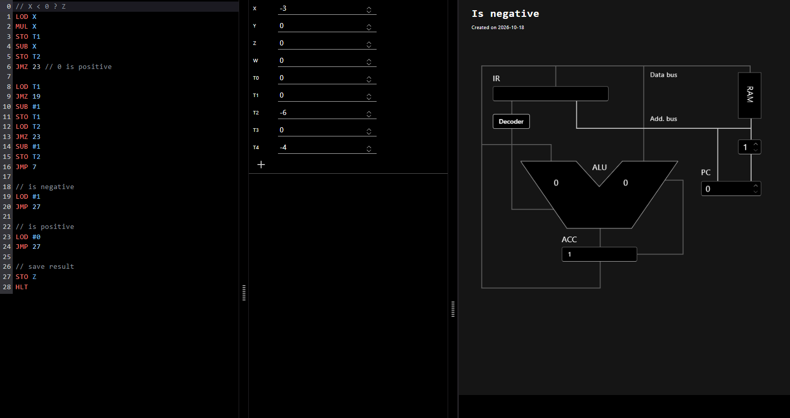 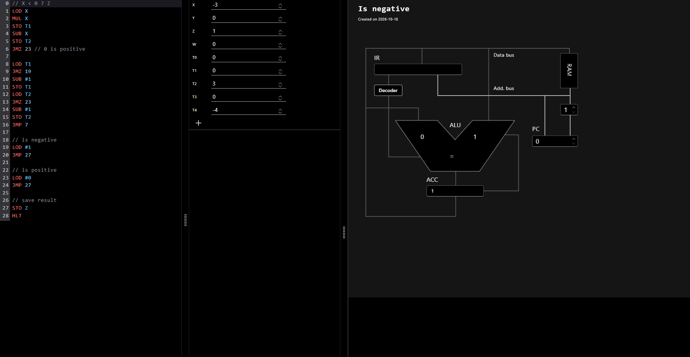

**Evaluation: Yes.** -3 < 0 → Z = 1. T1 and T2 are overwritten as a side effect. Cost grows roughly with X² iterations.

---

## Conclusions

1. All 11 programs produced the expected results for the chosen inputs.
2. The instruction set is minimal, so the programs rely on a few patterns:
   - **Counters:** loops are built from `LOD` / `SUB #1` / `STO` plus `JMZ` (programs 6, 7).
   - **Zero-test chains:** `SUB #1` followed by `JMZ` simulates a `switch` (program 5).
   - **Racing counters:** comparison and sign tests are done by decrementing two values and seeing which reaches 0 first (programs 8, 9, 11).
   - **Integer-division trick:** `(X/2)*2` isolates the parity of X (program 10).
3. Several programs destroy their inputs or helper variables as a side effect (Y in 6, Z in 7, X and Y in 8, T1-T4 in 9 and 11, Y in 10). The results are still correct.

## Limitations of this report

- Only one input set was run per program. Branches not executed in the simulator (other operations of program 5, X = Y, negative values in programs 8-10, odd X in program 10, positive X in program 11) are described from **code inspection / hand tracing**, not from simulator runs.
- In programs 8-11 the IR field is empty in the final screenshots, whereas in programs 1-7 it shows `HLT`. Final ALU readings in programs 7-11 could not be mapped to a specific instruction from the screenshots. These values are reported as observed, without interpretation.
- The claim that division is integer is inferred from program behavior, not from documentation.
- The program 1 inputs (2 + 2) coincide with 2 * 2 and are not ideal for demonstrating addition.
